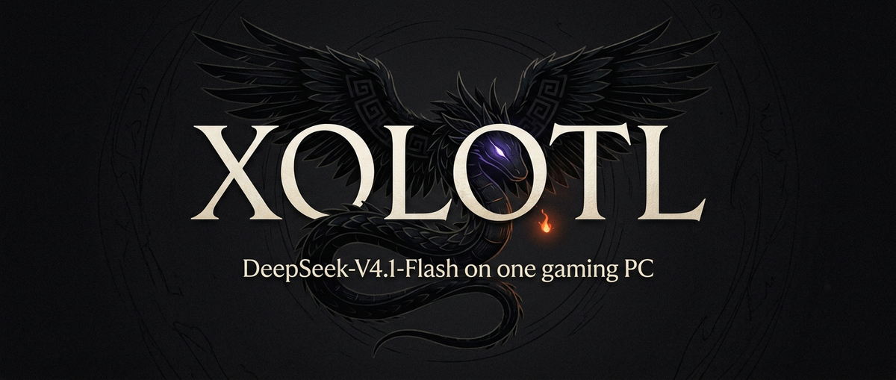

<p align="center"></p>

<h1 align="center">Xolotl</h1>

<p align="center"><b>DeepSeek-V4.1-Flash - all 552 billion parameters - on one gaming PC, at 27 tok/s.</b><br>
Plus GLM-5.3-Flash, Qwen3.8-Flash-Next and Qwen3.8-27B: one engine, one OpenAI / Anthropic-compatible server.<br>
Built on <a href="https://github.com/Niko1221/Strata">Strata</a> and heavily extended · Linux · NVIDIA · MIT</p>

> **A Strata fork.** Xolotl keeps [Strata](https://github.com/Niko1221/Strata)'s engine, server and kernels at its
> core (merged at 0.1.44.1) and adds ~71,000 lines on top: the DeepSeek-V4.1 and V4-Flash engines, the GLM-5.3-Flash
> engine and the Qwen3.8-27B dense port, each with its own quantisation and expert-tiering work.
>
> **Starred this as Strata-DSV4.1?** You are in the right place. Strata-DSV4.1 grew into **Xolotl**: the same
> DeepSeek-V4.1 engine (faster now), plus GLM-5.3-Flash and the Qwen3.8 models, in one tree. Old links and clones
> redirect here; nothing DeepSeek-V4.1 was removed.

## What one PC can do

**One RTX 4090 (24 GB) · Ryzen 7 5700X · 90 GB DDR4 · one NVMe drive.** Every number is measured on that machine,
through the real server, while it solved real tasks (21 HumanEval problems, 10 tool-call tasks, 3 agentic bug-fix
loops), greedy, thinking on with a 32K-token thinking budget.

| Model | Size | Writes | Reads | HumanEval | Tool calls | Agentic | Context |
| --- | ---: | ---: | ---: | ---: | ---: | ---: | ---: |
| **[DeepSeek-V4.1-Flash](https://huggingface.co/IndrasMirror/DeepSeek-V4.1-Flash-GSQ-Uncensored)** | 552B MoE | **26.8 tok/s** | **~210 tok/s** (8K prompt) | 21/21 | 10/10 | 3/3 | 512K |
| **GLM-5.3-Flash** | 320B MoE | ~28 tok/s | — | numbers coming | | | 512K |
| **Qwen3.8-Flash-Next** | 125B MoE | **127.8 tok/s** | 475 tok/s* | 21/21 | 10/10 | 3/3 | 200K |
| **Qwen3.8-27B** (dense) | 27B | **98.5 tok/s** | 1,097 tok/s* | 21/21 | 10/10 | 3/3 | 200K |

<sub>"Writes" = decode speed during those tasks; "Reads" = prompt prefill. \*Measured on the short HumanEval prompts,
not a long-prompt figure. DeepSeek-V4.1's 8K figure is a 7,806-token prompt; on 20K prompts it reaches ~350 tok/s.
GLM-5.3-Flash's full run is being redone with a decode-routing fix (see
[docs/xolotl/BENCHMARKS.md](docs/xolotl/BENCHMARKS.md)).</sub>

**What that means in practice:**

- **A 552B frontier model as a local coding agent.** Point Claude Code, Codex, opencode or Open WebUI at it - tool
  calls, streaming, prefix reuse across agent turns, a thinking budget.
- **No server farm.** The weights (152 GiB for DeepSeek-V4.1) live across VRAM, pinned RAM and NVMe; the engine
  carries up the experts each token needs.
- **Fast where it counts.** The Qwen models run at 100-130 tok/s; an agent's small follow-up turn on DeepSeek-V4.1
  costs ~7.6 s on a 6K context, and the engine learns the conversation's experts between turns.

## Quick start

Linux, an NVIDIA GPU with 24 GB, CUDA 12.x/13.x, and RAM for the arena (90 GB was used above).

```bash
git clone https://github.com/Indras-Mirror/Xolotl.git xolotl && cd xolotl
bash tools/xolotl/fetch-llama.sh   # llama.cpp at the pinned commit + tools/xolotl/ggml/xolotl-ggml.patch -> third_party/llama.cpp
cmake -S . -B build-xolotl -G Ninja -DCMAKE_BUILD_TYPE=Release -DSTRATA_ENABLE_CUDA=ON -DSTRATA_GGML_CUDA=ON \
  -DSTRATA_MMQ_KQUANTS=ON -DCMAKE_CUDA_ARCHITECTURES=89 -DSTRATA_GGML_DIR=$PWD/third_party/llama.cpp -DSTRATA_DSV41_FQ_OP=ON
ninja -C build-xolotl      # strata, strata-dense, glm_generate, ds41_generate, ds4_generate
```

Get a model: DeepSeek-V4.1-Flash is **[IndrasMirror/DeepSeek-V4.1-Flash-GSQ-Uncensored](https://huggingface.co/IndrasMirror/DeepSeek-V4.1-Flash-GSQ-Uncensored)**
(152 GiB, our GSQ mixed ternary / 2-bit / 3-bit quant - the card has the download and Engram steps). Then serve it
(edit the model paths in its config first):

```bash
python3 tools/v41/serve/serve_ds41.py --engine strata --config tools/v41/serve/strata-ds41.json --port 8150           # DeepSeek-V4.1-Flash
python3 tools/glm/serve/serve_glm.py  --engine strata --config tools/glm/serve/strata-glm-maya-abl-512k.json --port 8144  # GLM-5.3-Flash
python3 -m serve.server --engine strata --config <your-qwen-flash.json> --port 8130                                    # Qwen3.8-Flash-Next
python3 -m serve.server --engine strata --config <your-27b.json> --port 8090                                          # Qwen3.8-27B (exe: build-xolotl/strata-dense)
```

Then point any OpenAI- or Anthropic-compatible client at `http://127.0.0.1:<port>/v1`.

## How it works, in one paragraph

A mixture-of-experts model only uses a few experts per token. Xolotl keeps every expert somewhere - the hottest in
VRAM, tens of GiB in a pinned RAM arena the GPU reads by DMA, the rest on NVMe read at the drive's ceiling - and
moves the ones each token's router asks for, a layer ahead. Each model adds its own tricks: DeepSeek-V4.1 gets a
calibrated mixed-precision quantisation, speculative decoding with exact sampling, a bit-exact 4-bit KV cache for 512K
context and an arena that adapts to the conversation; GLM-5.3-Flash gets its abliteration LoRA on every path and soft
pruning; the Qwen models get MTP speculative decoding. **[Read the full write-up](docs/xolotl/HOW_IT_WORKS.md).**

## Read more

| | |
| --- | --- |
| [How Xolotl works](docs/xolotl/HOW_IT_WORKS.md) | the three memory tiers, per-model engines, the server, the agent-loop work |
| [Benchmarks](docs/xolotl/BENCHMARKS.md) | every measured number, exactness checks, how to measure your own PC |
| [DeepSeek-V4.1-Flash engine](docs/DEEPSEEK_V41.md) | GSQ quantisation, DSpark, the fp4 KV cache, Engram |
| [GLM-5.3-Flash engine](docs/glm) | KDA + MLA attention, the LoRA on routed experts, soft pruning |
| [Qwen3.8 / upstream Strata](README.strata.md) | the Strata engine this grew from |
| [Brand kit](docs/brand/XOLOTL_BRAND.md) | logo, banner, palette |

## Credits


Built on **[Strata](https://github.com/Niko1221/Strata)** by Niko1221 (its engine, server and kernels, merged at
0.1.44.1) and [ggml / llama.cpp](https://github.com/ggml-org/llama.cpp); the Qwen3.8-27B dense port is
[perronemirko](https://github.com/perronemirko/Strata)'s. The DeepSeek-V4.1 and GLM-5.3-Flash engines, the GSQ quant
and the unification are Indras Mirror's. Model weights: DeepSeek, Zhipu AI, Qwen, with quants and fine-tunes by
peasantsmith, ukisai, d0xin and gcsa-abliterix.

*Xolotl* is Quetzalcoatl's dark twin, who carries the dead up from the underworld - as the engine carries experts up
from RAM and NVMe. Research code from one developer, measured on one PC; reports from other hardware welcome. MIT.
